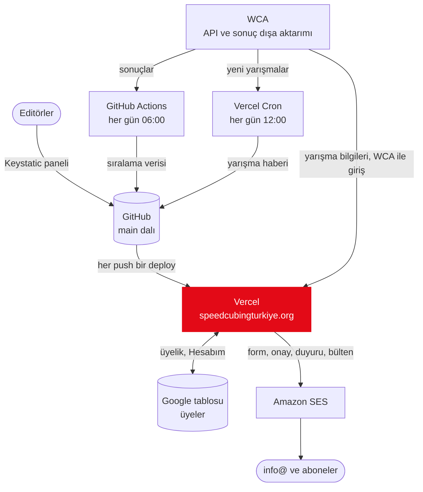

<p align="center">
  <a href="https://speedcubingturkiye.org">
    <picture>
      <source media="(prefers-color-scheme: dark)" srcset="public/brand/logo-long-inverted.svg">
      
    </picture>
  </a>
</p>

<p align="center">
  Türkiye'deki WCA yarışmaları, sıralamalar ve speedcubing topluluğu için site.<br>
  <a href="https://speedcubingturkiye.org"><b>speedcubingturkiye.org</b></a>
</p>

## Neler var

- Yarışma takvimi ve her yarışmanın kendi sayfası: kayıt durumu, kontenjan, yer, WCA Live bağlantısı
- 17 etkinlikte Türkiye sıralamaları, her sabah güncellenir. Üyeler isterse il sıralamasına da katılır.
- İlk kez yarışacaklar ve veliler için rehberler, sık sorulan sorular
- Haberler ve RSS. Türkiye'de yeni bir yarışma açılınca duyurusunu site kendisi yazar.
- E-posta bülteni
- Üyelik ve üyelerin kendi bilgilerini yönettiği Hesabım sayfası, WCA hesabıyla giriş
- Organizasyonun belgeleri, gönüllülük ve güvenli ortam sayfaları
- Türkçe ve İngilizce, açık ve koyu tema. İçerik tarayıcıdan, görsel bir editörle düzenlenir.

## Nasıl çalışır



Sitenin bir veritabanı yok. Sayfalar, haberler ve ayarlar bu repodaki dosyalar; panelden yapılan her değişiklik `main`'e bir commit olarak düşer ve Vercel her push'ta siteyi yeniden yayınlar. Yarışma bilgileri WCA API'sinden gelir, sıralamalar her sabah WCA'nın sonuç dışa aktarımından yeniden hesaplanır. Bülten aboneleri Amazon SES'te, üyeler Sekreter'in Google tablosunda durur.

Türkçe sayfalar kök adreste, İngilizceler `/en` altında. Site Next.js 16 (App Router), TypeScript, Tailwind CSS 4, next-intl, MDX ve Keystatic ile yazıldı. Şemadaki saatler Türkiye saati.

## Başlarken

Node 24 ve pnpm 11 gerekiyor.

```bash
pnpm install
cp .env.example .env.local
pnpm dev
```

Site `http://localhost:3000` adresinde açılır. Hiçbir anahtar girmesen de çalışır; o zaman mailler gönderilmez, konsola yazılır. Görsel editör `http://localhost:3000/keystatic` adresinde. Yerelde giriş istemez, dosyaları doğrudan diskte değiştirir.

| Komut | Ne yapar |
|---|---|
| `pnpm dev` | Geliştirme sunucusu |
| `pnpm build` | İçerik kontrolü, ardından production build |
| `pnpm start` | Build'i sunar |
| `pnpm lint` | ESLint |
| `pnpm typecheck` | TypeScript kontrolü |
| `pnpm test` | Vitest testleri |
| `pnpm tsx scripts/check-content.ts` | Yalnız içerik kontrolü |
| `pnpm data:rankings` | Sıralama verisini WCA'dan yeniden üretir |
| `pnpm og` | Paylaşım görselini (`public/og.png`) logodan üretir |
| `MSYS_NO_PATHCONV=1 powershell -ExecutionPolicy Bypass -File scripts/smoke.ps1 -Paths /,/en` | Build'i 3010 portunda açar, sayfaların HTTP kodlarını yazar ve kapatır (Windows, Git Bash) |

## Ayrıntılar

<details>
<summary><b>İçerik</b></summary>

Sayfalar ve haberler repodaki MDX dosyaları. Her sayfanın Türkçesi de İngilizcesi de olmalı; biri eksikse build durur.

```text
content/tr/pages/<slug>.mdx     sayfa (Türkçe)
content/en/pages/<slug>.mdx     aynı sayfa (İngilizce)
content/news/<slug>/index.yaml  haber bilgileri: iki dilde başlık ve özet, tarih, kategori
content/news/<slug>/tr.mdx      haber metni (Türkçe)
content/news/<slug>/en.mdx      haber metni (İngilizce)
content/home/slides.json        ana sayfa slaytları, iki dil bir arada
```

Adresi dosya yolu belirler: `content/tr/pages/yarismalar/sss.mdx` hem `/yarismalar/sss` hem `/en/yarismalar/sss` olur. Dosya adlarında küçük harf, rakam ve tire kullan; Türkçe karakter olmasın.

#### Sayfa eklemek

1. İki dosyayı birlikte oluştur, `content/tr/pages/<slug>.mdx` ve `content/en/pages/<slug>.mdx`:

   ```mdx
   ---
   title: "Sayfa başlığı"
   description: "Arama motorları ve sayfa üstü için tek cümle"
   updated: "2026-09-25"
   ---

   Metin buraya. Başlık için `##`, liste için `-`, tablo için GFM tablosu.
   ```

2. Sayfanın bir rotası olmalı. En kolayı `app/[locale]/kvkk/page.tsx` dosyasını `app/[locale]/<slug>/page.tsx` olarak kopyalayıp `SLUG` sabitini değiştirmek. Sayfa yan menülü bir bölümdeyse (yarışma ya da organizasyon sayfaları) o bölümden bir sayfayı örnek al.
3. Gerekiyorsa footer'a (`components/Footer.tsx`) ve site haritasına (`app/sitemap.ts`) ekle.

#### Haber eklemek

En kolayı panel: `/keystatic` > Haberler ([editör rehberi](docs/editor-kullanim.md)). Elle eklemek istersen `content/news/<slug>/` klasörünü aç ve bir `index.yaml` yaz:

```yaml
title: "Başlık (TR)"
titleEn: "Title (EN)"
description: "Listede görünen özet"
descriptionEn: "Summary shown in the list"
date: 2026-10-01
category: yarisma
auto: false
bulten: false
```

`tr.mdx` ve `en.mdx` dosyalarında yalnız metin olur; başlık bilgileri `index.yaml`'da durur.

`category` şunlardan biri: `yarisma`, `topluluk`, `rekor` ya da `ilan`. İlanlar `/belgeler` sayfasında da çıkar. `auto: true` yalnız cron'un yazdığı duyurularda bulunur ve habere "otomatik" rozeti ekler. Rota eklemene gerek yok; haber `/haberler/<slug>` adresinde ve RSS'te kendiliğinden yayımlanır.

#### Ana sayfa slaytları

Slaytlar `content/home/slides.json` dosyasında durur ve normalde panelden düzenlenir. İki tür slayt var: elle yazılanlar (başlık, kısa metin, bir ya da iki düğme, isteğe bağlı fotoğraf ve yerleşim) ve sıradaki yarışmayı WCA verisinden kendisi dolduran slayt; onun yalnız fotoğrafı ve yerleşimi elle seçilir. Alanların kuralları `lib/slides.ts`'te; hatalı bir slayt build'i dosya adı ve slayt numarasıyla durdurur. Yerleşimlerin nasıl göründüğü [editör rehberinde](docs/editor-kullanim.md).

#### MDX bileşenleri

Panel ham HTML tanımadığı için MDX'te yalnız şu bileşenleri kullanabilirsin:

| Bileşen | Ne işe yarar |
|---|---|
| `<Details summary="Soru?">…</Details>` | Açılır SSS maddesi. İçerikle etiketler arasında boş satır bırak. |
| `<Callout title="Başlık" lang="en">…</Callout>` | Vurgulu not kutusu. `title` ve `lang` isteğe bağlı; `lang` yalnız kutu sayfanın dilinden farklıysa gerekir. |
| `<DataController field="name" />`, `field="email"` | Site ayarlarındaki KVKK veri sorumlusu |
| `<MdxLink href="/kvkk" locale="tr">metin</MdxLink>` | Öbür dildeki bir sayfaya bağlantı |
| `<Anchor id="bulten" />` | Başlığın hemen üstüne konan sayfa içi hedef (`/kvkk#bulten`) |
| `<Lang code="en">Speedcubing</Lang>` | Büyük harfli bir başlıkta öbür dilden bir kelime (İ/I kuralı) |

İç bağlantıları iki dilde de öneksiz yaz, örneğin `[SSS](/yarismalar/sss)`; `/en` kendiliğinden eklenir. Dış bağlantılar yeni sekmede açılır. Metinde `<` ya da `{` kullanman gerekirse başına ters eğik çizgi koy (`\<`, `\{`), yoksa MDX onları etiket ya da kod sanar.

#### İçerik kontrolü

`pnpm build` önce `scripts/check-content.ts` ile içeriği kontrol eder. Bir sorun bulursa build durur ve canlı site son sağlam hâliyle kalır. Hata mesajları Türkçe; hangi dosyada hangi alanın sorunlu olduğunu söyler. Kontrol edilenler:

- Her sayfanın iki dili de var.
- Sayfalar, haberler, slaytlar, arayüz metinleri, site ayarları ve galeri panelin şemasına (`keystatic.config.ts`) uyuyor.
- Her haberde iki dilde metin ve geçerli bir tarih var.
- MDX'te yalnız yukarıdaki bileşenler var; ham HTML ya da kaçışsız `{` yok.
- `messages/tr.json` ile `messages/en.json` aynı anahtarları ve yer tutucuları taşıyor.
- Adı geçen her görsel ve belge gerçekten var, görseller 5 MB'ı geçmiyor.

#### Panel commit'leri

Canlıdaki panel her kaydı `main`'e `chore(content): update <yol>` mesajıyla, her silmeyi `chore(content): delete <yol>` ile commit'ler. Bu mesajlar `patches/@keystatic__core@0.6.9.patch` yamasından geliyor. Keystatic'i yükseltirken yamayı da yeni sürüme taşı: `pnpm patch @keystatic/core@<sürüm>`.

</details>

<details>
<summary><b>Yapılandırma ve ortam değişkenleri</b></summary>

Site adı, adresi ve iletişim adresleri `site.config.ts`'te. Panelden düzenlenen ayarlar ise şurada:

- `content/site.json`: KVKK veri sorumlusu, sosyal kanallar (boş bırakılan kanal sitede görünmez) ve yönetim listesi
- `content/documents/<adres>.yaml`: `/belgeler` sayfasındaki belgeler; PDF'leri `public/docs/<adres>/` altında
- `content/gallery.json`: `/medya` galerisi
- `messages/tr.json`, `messages/en.json`: arayüz metinleri

Ortam değişkenlerinin tam listesi `.env.example`'da. Vercel'de `SAFEGUARDING_EMAIL` dışında hepsi Production'da tanımlı; `CONTACT_EMAIL` ve `MAIL_FROM` Preview'da da var.

| Değişken | Ne için |
|---|---|
| `SES_ACCESS_KEY_ID`, `SES_SECRET_ACCESS_KEY` | Amazon SES anahtarı. IAM kullanıcısı (`speedcubingturkiye-web-ses`) yalnız sitenin adresleri adına gönderebilir ve yalnız `bulten` listesine erişir. |
| `NEWSLETTER_SECRET` | Maillerdeki linkleri şifreleyen ve imzalayan anahtar, en az 32 karakter. Değişirse eski maillerdeki linkler çalışmaz. |
| `BULTEN_SECRET` | `/api/bulten/gonder` rotasının anahtarı. GitHub'da yalnız `bulten` ortamında durur. |
| `BULTEN_KAPALI` | `1` olursa elle bülten gönderimi kapanır. Yeni deploy'la geçerli olur. |
| `CONTACT_EMAIL` | Form mesajlarının gittiği adres (`info@speedcubingturkiye.org`) |
| `SAFEGUARDING_EMAIL` | İletişim formunda "Güvenlik" konusunun gittiği adres. Boşsa `guvenlik@speedcubingturkiye.org`; yerelde denerken kendi adresini yaz. |
| `MAIL_FROM` | Haber ve duyuruların gönderen adresi (`news@speedcubingturkiye.org`). Onay mailleri ve form bildirimleri `noreply@speedcubingturkiye.org` adresinden gider. |
| `MEMBERSHIP_SCRIPT_URL` | Üyelik tablosundaki Apps Script web uygulamasının adresi (`…/exec`). Yoksa Üye ol formu "şu an kapalı" der. |
| `MEMBERSHIP_SCRIPT_SECRET` | Betiğin Script Properties'teki `SECRET` değeriyle aynı, uzun ve rastgele bir değer |
| `WCA_CLIENT_ID`, `WCA_CLIENT_SECRET` | WCA OAuth uygulamasının anahtarları (WCA'da `/oauth/applications`). Dönüş adresi `https://speedcubingturkiye.org/api/wca/donus`, kapsamlar `public email dob`. Tanımlı değilse sitedeki WCA düğmeleri görünmez. |
| `CRON_SECRET` | `/api/cron/wca-check` rotasının anahtarı |
| `GITHUB_TOKEN`, `GITHUB_REPO` | Cron'un haber commit'leyebilmesi için yalnız bu repoya yazabilen fine-grained token ve `owner/repo` |
| `NEXT_PUBLIC_KEYSTATIC_REPO` | Panelin commit attığı repo (`owner/repo`) |
| `KEYSTATIC_GITHUB_CLIENT_ID`, `KEYSTATIC_GITHUB_CLIENT_SECRET`, `KEYSTATIC_SECRET`, `NEXT_PUBLIC_KEYSTATIC_GITHUB_APP_SLUG` | Panelin GitHub App bağlantısı. Değerleri Keystatic'in kurulum sihirbazı verir. |

Yerelde birkaç şey farklı çalışır:

- SES anahtarı yoksa mailler gönderilmez, linkleriyle birlikte konsola yazılır. `.env.local`'da gerçek SES anahtarları varsa form, onay ve çıkış gerçek listeye yazar; buna dikkat et.
- `NEWSLETTER_SECRET` yoksa geliştirmeye özel sabit bir anahtar kullanılır.
- `next dev` hiçbir zaman toplu mail atmaz: cron kuru çalışır, elle bülten rotası 503 döner.
- Üyelik betiğinin değişkenleri yoksa Üye ol formu tabloya yazmaz, satırı konsola basar ve başvuruyu başarılı sayar. Hesabım da örnek bir üyeyle açılır.
- WCA anahtarları yoksa WCA düğmeleri hata mesajıyla döner ve il listeleri boş görünür.

</details>

<details>
<summary><b>Üyelik</b></summary>

Üye ol formu başvuruları ortak drive'daki bir Google tablosuna yazar. Arada `scripts/uyelik-apps-script.gs` betiği var: tablo bir Apps Script web uygulaması olarak yayınlanır ve site onunla konuşur. Başvuran kişi e-postasına gelen linke tıklayınca "Üye" olur; yedi gün içinde onaylanmayan başvurular silinir.

#### Kurulum

Kurulumu süper admin hesabı yapmalı, çünkü betik onu yayınlayanın hesabıyla çalışır.

1. Tabloyu aç, Uzantılar > Apps Script.
2. `scripts/uyelik-apps-script.gs` dosyasını yapıştırıp kaydet. "Üyeler" sekmesi ve başlıklar ilk başvuruda kendiliğinden oluşur. Baştaki `@OnlyCurrentDoc` satırı betiğin yalnız bu tabloya erişmesini sağlar; onu silme.
3. Proje ayarları > Script Properties'e `SECRET` adıyla uzun, rastgele bir değer ekle.
4. Dağıt > Yeni dağıtım > Web uygulaması: "Execute as: Me", "Who has access: Anyone". Çıkan `…/exec` adresini kopyala.
5. Tetikleyiciler > Tetikleyici ekle: işlev `cleanup`, "Zamana dayalı", "Gün zamanlayıcı". Onaylanmamış başvuruları bu tetikleyici temizler.
6. Vercel'e `MEMBERSHIP_SCRIPT_URL` (adres) ve `MEMBERSHIP_SCRIPT_SECRET` (aynı değer) ekle, yeniden deploy et.
7. Canlıda bir deneme başvurusu yap. Tabloda "Onay bekliyor" satırı belirmeli, maildeki linke tıklayınca "Üye" olmalı.

Betiği güncellerken yeni bir dağıtım açma; mevcut dağıtımı yeni sürümle güncelle (Dağıtımları yönet > Düzenle > Yeni sürüm). Böylece adres değişmez.

#### Tablo

A'dan M'ye kadar olan sütunlarda başvurunun kendisi var: ad, e-posta, doğum tarihi, şehir, veli onayı ve onay bilgileri. N'den S'ye kadar olan sütunları betik kendisi açar ve doldurur: WCA doğrulandı, İl sıralaması, İl tarihi, Üye no, Telefon ve Sohbet grupları. Bu sütunlarda bir tarih "evet" demek. T ve sağındaki sütunlar notlar için boş.

Sütunların yerini değiştirme; betik onları sırasına göre okur. R ve S'nin başlıkları değişirse betik durur. Telefonu e-postanın yanında görmek istersen aradaki sütunları gruplayabilir ya da A'dan E'ye kadar olan sütunları dondurabilirsin.

Her üyeye, üyeliğinin başladığı yıla ve sıraya göre bir numara verilir (`2026-0001` gibi). Sayaç betiğin Script Properties'inde durur; bir numara ikinci kez kullanılmaz.

Bir posta kutusu tek üyelik demek. Adresler küçük harfle, "+" eki olmadan ve Gmail'de noktasız saklanır; yani `kutay.temel@gmail.com` ile `kutaytemel@gmail.com` aynı üyelik.

#### Hesabım ve WCA

Üyeler `/hesabim` sayfasında bilgilerini düzeltir, e-posta adreslerini değiştirir, WCA hesaplarını bağlar, il sıralamasına katılır ya da üyelikten ayrılır. Sayfa e-postaya gelen bir saatlik linkle ya da WCA ile girişle açılır; çerez kullanılmaz. Aynı adrese on dakikada en fazla bir link gider.

Maillerdeki onay linkleri doğrudan onaylamaz, önce bir sayfa açar; onay o sayfadaki düğmeyle olur. Böylece linki önceden açan posta tarayıcıları (Outlook'un Safe Links'i gibi) yanlışlıkla onay vermiş olmaz.

WCA ID artık elle yazılmıyor, yalnız WCA girişiyle geliyor; eskiden elle yazılanlar tabloda doğrulanmamış görünür. Üye ol'daki "WCA ile kaydol" düğmesi formu WCA'daki ad, e-posta, doğum tarihi ve WCA ID ile doldurur. E-posta WCA'dakiyle aynıysa onay maili beklenmeden üyelik başlar.

İl sıralamasına yalnız WCA ID'si doğrulanmış üyeler katılabilir. Sıralamaya giren üyenin şehri bir yıl boyunca değiştirilemez; başlangıç tarihi P sütununda. Taşınan biri olursa P'yi silmek yeter. Sıralama sayfaları listeyi tablodan saatte bir okur.

#### WhatsApp

Telefon numarası Üye ol formunda ve Hesabım'da zorunlu. Numaralar ülke koduyla, `+905054182759` biçiminde R sütununa yazılır. Sabit hatlar ve 555 55 55 gibi uydurma numaralar kabul edilmez.

Sekreter her yeni üyeyi bu numarayla WhatsApp topluluğuna ekler, "Sohbet grupları" sütununda tarih olanları sohbet gruplarına da. Bu kutuyu sonradan kaldıranlar gruplardan çıkarılır. Üyelikten ayrılanın satırı hemen silindiği için ayda bir topluluğun üye listesini tabloyla karşılaştırıp tabloda olmayanları çıkarmak gerekiyor. Aydınlatma metni bunun 30 gün içinde yapılacağını söylüyor.

#### Bülten sekmesi

Tablonun "Bülten" sekmesi, SES'teki onaylı abonelerin bir kopyası: e-posta, dil, onay tarihi ve bir "Sil" kutusu. Günde bir kez kendiliğinden ya da "Bülten > Listeyi yenile" menüsüyle yenilenir. Yenilenirken "Sil" işaretli adresler SES'ten silinir ve sekme baştan yazılır. Bu yüzden sekmede elle yapılan değişiklikler kalıcı olmaz; işe yarayan tek şey "Sil" kutusu.

Kurulumu süper admin yapar:

1. Betiği güncelle ve yeni sürümü yayınla.
2. Editörde `refreshNewsletter` işlevini bir kez çalıştır. Google dış bağlantı için izin ister; ver. Sekme oluşur.
3. Tetikleyici ekle: işlev `refreshNewsletter`, "Zamana dayalı", "Gün zamanlayıcı".
4. Menü, tablo yeniden açılınca görünür. Sekreter menüyü ilk kullandığında Google ondan da bir kez izin ister.

</details>

<details>
<summary><b>E-posta ve bülten</b></summary>

Bütün mailler Amazon SES'ten (`us-east-1`) gider. Haber ve duyurular `news@`, onay mailleri ve form bildirimleri `noreply@` adresinden çıkar; yanıtlar info@'ya ya da formu dolduran kişiye gider. Maillerde takip pikseli yok, başka bir sunucudan görsel de yüklenmez.

#### İletişim formu

Mesajlar info@'ya "Speedcubing Türkiye: <konu>" konusuyla ve "<ad soyad> (form)" gönderen adıyla düşer; "Yanıtla" doğrudan yazan kişiye gider. "Güvenlik" konusundaki mesajlar ayrı bir adrese gider (`SAFEGUARDING_EMAIL`).

Spam'e karşı birkaç önlem var. Formda botların doldurduğu gizli bir alan var ve form üç saniyeden hızlı gönderilemez. Bir de görünmez bir doğrulama var: form ilk odaklandığında tarayıcı siteden imzalı küçük bir problem alır ve bir saniyeden kısa sürede çözer (`lib/pow.ts`). Sayfayı çalıştırmadan gönderen botlar bunu geçemez; bunun için dışarıya istek gitmez, çerez de kullanılmaz. Son olarak `search-speedcubingturkiye.org` gibi bize benzeyen adreslerden yazanlara "gönderildi" denir ama mail gitmez.

#### Bülten

Abone olmak isteyen kişi SES'teki `bulten` listesine "onay bekliyor" olarak yazılır ve formun dilinde bir onay maili alır. Aynı adrese 24 saatte en fazla bir onay maili gider. Onay linki yedi gün geçerli; onaylanmayan adresleri cron yedi gün sonra siler.

Her mailin altında abonelikten çıkış linki var. Gmail ve Apple Mail'in kendi "Abonelikten çık" düğmesi de tek tıkla çıkarır. Linklerdeki bilgiler şifreli, e-posta adresi linkte görünmez.

Türkiye'de yeni bir yarışma açılınca cron haberini commit'ler ve onaylı abonelere kendi dillerinde gönderir. Türkçe bir kopyası da info@'ya gelir.

Elle bülten göndermek için paneldeki haberde "Bültenle gönder" kutusunu işaretleyip kaydet. Gerisini `.github/workflows/bulten.yml` yapar: sitenin o hâli yayına girene kadar bekler, sonra GitHub'daki `bulten` ortamında onay ister. Önizleme `/bulten/onizleme/<slug>` adresinde. Onay verilince bülten gider. Haber bu arada değiştiyse gönderim durur ve yeni hâli tekrar onaya düşer. Aynı haber iki kez gönderilmez ve günde en fazla bir bülten gider; gönderilenlerin kaydı `content/newsletter-log.json`'da. `BULTEN_KAPALI=1` gönderimi tamamen durdurur.

Onay adımı panelden gelen bültenlere ikinci bir göz. Ama repoya push edebilen biri, çalınmış bir panel token'ı dahil, Production anahtarlarıyla her şeyi yapabilir. Bu yüzden yazma yetkisini dar tut ([yayın kontrol listesi](docs/yayin-kontrol-listesi.md), §3).

SES saniyede en fazla 10 mail gönderiyor ve bir gönderim Vercel'in 300 saniyelik sınırına sığmak zorunda; bu da en kötü durumda yaklaşık 850 mail demek. Abone sayısı 800'e yaklaşınca gönderimi parçalara bölmek gerekecek. Aynı gün birkaç yarışma açılırsa duyuruları aynı 300 saniyeyi paylaşır ve yarıda kalan gönderim tekrar denenmez.

</details>

<details>
<summary><b>Sıralama verisi</b></summary>

`/siralamalar` sayfaları veriyi repodaki `data/rankings/` klasöründen okur. `meta.json` dışa aktarımın tarihini ve format sürümünü tutar; geri kalanı etkinlik ve tür başına birer dosya, örneğin `single/333.json`. Her satır `[ulusal sıra, WCA ID, isim, sonuç]`.

Türkiye'yi temsil etmiş herkes listede. Sayfa 25, 50, 100 ya da 500 satır gösterir; "Sıramı bul" isimle ya da WCA ID ile arar.

Sıralama toplamı (`/siralamalar/toplam/tekli`, `/siralamalar/toplam/ortalama`) ve Kinch (`/siralamalar/kinch`) aynı dosyalardan hesaplanır (`lib/all-round.ts`). Sıralama toplamı, her etkinlikteki ulusal sıraların toplamı; sonucu olmayan etkinlikte, WCA Statistics'teki gibi, o etkinliğin son sırasının bir fazlası sayılır. Kinch'te her etkinlik için 100 × Türkiye rekoru ÷ kişinin en iyisi hesaplanır ve genel puan 17 etkinliğin ortalamasıdır.

`pnpm data:rankings` WCA'nın resmi sonuç dışa aktarımına (Results Export v2) bakar. Yeni bir dışa aktarım varsa yaklaşık 378 MB'lık zip'i indirir, yalnız `results` ve `persons` tablolarını açar ve dosyaları yeniden yazar. Tarih değişmemişse bir şey yapmaz.

Sıralama kuralı WCA'nın ulusal sıralamasıyla aynı: Türkiye'yi temsil ederken alınan sonuçlar sayılır, vatandaşlığını sonradan değiştiren biri Türkiye dönemindeki sonuçlarıyla listede kalır. Herkesin her etkinlikteki en iyi tekli ve ortalaması alınır; eşit sonuçlar aynı sırayı paylaşır.

Komutun birkaç seçeneği var: `--force` tarih aynı olsa da işler, `--from-dir <klasör>` indirmeden, açılmış bir dışa aktarımı kullanır, `--out <klasör>` başka bir klasöre yazar. Bir şey ters giderse hiçbir dosyaya dokunmadan hata verir: format sürümü 2 değilse, bir tablo ya da sütun eksikse ya da 100 satırdan uzun bir sıralama %10'dan fazla kısalırsa.

`.github/workflows/daily-data.yml` bu komutu her gün 06:00'da çalıştırır. Veri değiştiyse `main`'e bir commit atar ve site her zamanki gibi yeniden yayınlanır. Actions sekmesindeki "Run workflow" ile elle de çalıştırabilirsin.

</details>

<details>
<summary><b>Marka dosyaları</b></summary>

`public/brand/` klasöründe:

- `logo-long.svg`, `logo-long.png`: yatay logo
- `logo-mark.svg`, `logo-mark.png`: yalnız işaret
- `logo-long-inverted.svg`, `logo-mark-inverted.svg`: koyu zemin için
- `logo-mail.png`: maillerdeki logo

Hepsi marka kitinden (brand-identity.pdf v1.0) geliyor. Renkler `app/globals.css`'te: kırmızı `#E30A17`, siyah `#1A1A1A`. Kullanım kuralları sitenin `/medya` sayfasında. Paylaşım görseli `public/og.png` ve `pnpm og` ile üretiliyor. Site ikonları (`app/icon.svg`, `app/favicon.ico`, `app/apple-icon.png`) logonun kare işaretinden yapıldı.

Diğer statik dosyalar:

- `public/docs/<adres>/`: belgelerin PDF'leri (`tr.pdf`, `en.pdf`), panelin Belgeler bölümünden yüklenir.
- `public/galeri/`: galeri fotoğrafları, panelin Galeri bölümünden yüklenir. Liste boşken yer tutucu kareler görünür.
- `public/images/news/`, `public/images/slides/`: haber ve slayt fotoğrafları, onlar da panelden yüklenir.

</details>

<details>
<summary><b>Yayın</b></summary>

`main`'e her push Vercel'de bir production deploy'u, her pull request de bir preview başlatır. Ayrı bir CI yok; build zaten içerik kontrolünü ve TypeScript'i çalıştırdığı için kapı görevini o görüyor.

Alan adları Vercel'de. Asıl adres `speedcubingturkiye.org`; `www` ve `speedcubingturkiye.com` ona yönlenir. Güvenlik başlıkları `next.config.ts`'te: başka siteler sayfaları çerçeveleyemez (`X-Frame-Options: DENY`, CSP `frame-ancestors 'none'`), `nosniff` ve `Referrer-Policy` açık, `X-Powered-By` gönderilmez. HSTS'yi Vercel ekliyor.

GitHub Actions'ta iki iş var: günlük sıralama verisi ve onaylanan bültenlerin gönderimi. Vercel Cron da her gün 12:00'de `/api/cron/wca-check` rotasını çağırır. Bu rota yeni WCA yarışmalarını haber olarak commit'ler, abonelere duyurur ve yedi günü geçmiş onaysız adresleri siler. Hobby planda cron günde yalnız bir kez çalışabiliyor.

Cron'u yerelde kuru çalıştırmak için:

```bash
curl -H "Authorization: Bearer $CRON_SECRET" "http://localhost:3000/api/cron/wca-check?dry=1"
```

</details>

## Belgeler

- [Editör rehberi](docs/editor-kullanim.md): panelle içerik düzenleme
- [Yayın kontrol listesi](docs/yayin-kontrol-listesi.md): kurulum adımları ve canlı testler
- [Değişiklik günlüğü](CHANGELOG.md)

## Teşekkür

Telefon alanındaki bayraklar [Twemoji](https://github.com/twitter/twemoji) çizimleri (© Twitter, Inc. ve katkıda bulunanlar, [CC BY 4.0](https://creativecommons.org/licenses/by/4.0/)). Yazı tipi bu çizimlerin bayrak alt kümesi ve [country-flag-emoji-polyfill](https://github.com/talkjs/country-flag-emoji-polyfill) (MIT) paketinden geliyor.
